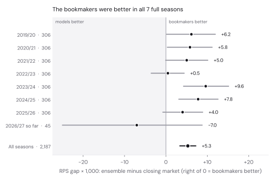
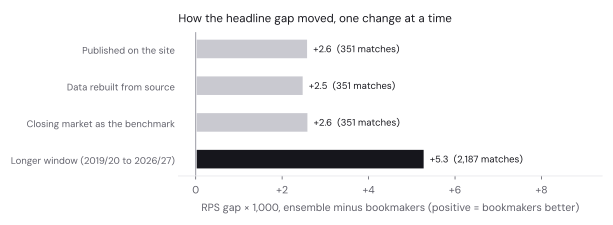

# Models v bookmakers: the long backtest

*16 October 2026. Every number below comes from [`results.json`](results.json) and [`verify_sources.json`](verify_sources.json), written by the scripts in [`analysis/pipeline/`](../pipeline/). The Colab notebook [`backtest.ipynb`](backtest.ipynb) reproduces all of it.*

## The short version

Over 2,187 Bundesliga matches since 2019/20, the bookmakers' closing odds beat the models: RPS 0.1980 against 0.2033 for the ensemble. The gap of 0.0053 has a 95% interval of 0.0034 to 0.0072, so it isn't luck. The bookmakers were better in every one of the seven full seasons. The models lead 2026/27 so far, but that's 45 matches, and the interval runs from −0.025 to +0.009.

The figure the site showed before, 0.0026, was right for the 351 matches it covered. Those matches happened to include one of the models' better seasons.

**RPS** (ranked probability score) measures how far the home/draw/away probabilities were from what happened, giving partial credit for near misses (a draw is closer to a home win than an away win is). Lower is better. Saying one-third for everything scores 0.2367 on these matches, and the market scores 0.1980. Read the gap against that 0.039 spread: the ensemble gets about 86% of the way from coin-flipping to the market.

## What changed, and what each change did

| Change | Before | Now |
|---|---|---|
| Benchmark | Bet365's early-week prices for 2025/26 and matchday 1 (from the GitHub mirror), market-average closing odds for matchdays 2–5, a single Bet365 quote in each post | Market-average closing odds (football-data.co.uk `AvgC`), margin removed proportionally, for every match |
| Data | GitHub mirror (xgabora) for history plus 2026/27 rows transcribed into each notebook | Downloaded straight from football-data.co.uk, byte-for-byte, with a SHA-256 checksum per file |
| Window | 2025/26 and 2026/27 so far, 351 matches | 2019/20 to 2026/27 so far, 2,187 matches (every season with closing averages) |
| Dixon–Coles tuning | Time decay picked on 2022/23, inside the long window | Picked on 2018/19, the season before the window (0.0019) |

1. **Rebuilding from source: 0.0026 → 0.0025.** Same 351 matches, same mixed benchmark. The Gladbach fix (below) and the fresh Bayesian refits barely moved it.
2. **Closing odds as the benchmark: 0.0025 → 0.0026.** Mixing benchmarks was wrong in principle and tiny in practice. Over the whole window the four candidate benchmarks are close:

   | Benchmark | RPS | Ensemble's gap |
   |---|---|---|
   | Market average, closing (used) | 0.1980 | 0.0053 |
   | Bet365, closing | 0.1981 | 0.0052 |
   | Market average, early-week | 0.1984 | 0.0049 |
   | Bet365, early-week | 0.1985 | 0.0048 |

3. **The longer window: 0.0026 → 0.0053.** This is the whole story. 2025/26 (0.0040) and 2022/23 (0.0005) were the models' best full seasons; 2023/24 (0.0096) was the worst.

## Results

All 2,187 matches, each forecast made only from matches played before it:

| Forecaster | RPS | Log loss | Top pick right |
|---|---|---|---|
| Bookmakers (closing average) | 0.1980 | 0.974 | 53.3% |
| Ensemble (equal weights, fixed in advance) | 0.2033 | 0.992 | 51.8% |
| Dixon–Coles | 0.2035 | 0.992 | 51.7% |
| Bayesian shots-to-goals | 0.2038 | 0.994 | 51.3% |
| XGBoost | 0.2060 | 1.000 | 50.7% |

By season (RPS; gap = ensemble minus bookmakers, with 95% interval):

| Season | Matches | Bookmakers | Ensemble | Gap | 95% interval |
|---|---|---|---|---|---|
| 2019/20 | 306 | 0.2042 | 0.2103 | +0.0062 | +0.0001 to +0.0119 |
| 2020/21 | 306 | 0.1967 | 0.2025 | +0.0058 | +0.0003 to +0.0112 |
| 2021/22 | 306 | 0.2025 | 0.2076 | +0.0050 | −0.0001 to +0.0101 |
| 2022/23 | 306 | 0.2041 | 0.2046 | +0.0005 | −0.0036 to +0.0044 |
| 2023/24 | 306 | 0.1847 | 0.1943 | +0.0096 | +0.0043 to +0.0151 |
| 2024/25 | 306 | 0.2016 | 0.2094 | +0.0078 | +0.0031 to +0.0126 |
| 2025/26 | 306 | 0.1901 | 0.1941 | +0.0040 | −0.0007 to +0.0089 |
| 2026/27 so far | 45 | 0.2131 | 0.2060 | −0.0070 | −0.0250 to +0.0088 |

**When the models and the market disagree** about the bookmakers' favourite (probability of the favourite winning):

| Models compared with the market | Matches | Models said | Market said | Favourite actually won |
|---|---|---|---|---|
| 7+ points less sure | 467 | 50.2% | 60.9% | 64.5% |
| 3–7 points less sure | 528 | 50.9% | 55.8% | 55.9% |
| Within 3 points | 828 | 50.0% | 50.3% | 49.6% |
| 3+ points more sure | 364 | 53.7% | 47.3% | 43.7% |

In both directions, reality went past the market, away from the models. A disagreement has been a reason to trust the bookmakers, not to bet against them.

## Data checks

**The posts' embedded 2026/27 rows.** Matchday 6: 45 rows, 630 numbers, all identical to the source file. Matchday 5: 36 rows, 432 numbers, 3 differ. All three are the closing odds of Leverkusen v Union Berlin (5 September 2026): 1.38 / 5.38 / 6.69 in the notebook against 1.34 / 5.43 / 7.38 in today's file. Either football-data.co.uk revised them or the transcription slipped; there's no way to tell now. No forecast changed, because odds aren't a model input; they only set the market benchmark for that one backtest match.

**The GitHub mirror.** Of its 15,331 1. and 2. Bundesliga matches, 14,465 match the source on date and clubs, with identical goals, shots, shots on target and red cards in all but one match. The other 866 are spelling splits:

- **Gladbach** is "MGladbach" up to 2024/25 and "M'gladbach" after, so the old pipeline treated them as two clubs. Gladbach entered every 2025/26 forecast with at most a season of history instead of its full record. The aggregate effect turned out small (step 1 above), but it was a real bug.
- Kaiserslautern carries a trailing space in 2008/09, and Preußen Münster has two spellings in 2024/25.
- The one field difference is Union Berlin v Bochum, 14 December 2024: the mirror has the on-pitch 1–1, football-data.co.uk the awarded 0–2 (the lighter incident) with no match statistics.

The mirror's odds columns equal Bet365's early-week prices for every match since 2025/26, which confirms the mixed benchmark.

**Elo.** The mirror's Elo columns were loaded but never used: the models compute their own Elo from results. The earlier data review got this wrong.

**Bayesian fits.** 71 monthly NUTS refits (250 warm-up and 250 draws per chain, 2 chains, as in the posts). 150 of 35,500 draws diverged (0.4%), but three fits had 20 or more (April 2021, February 2024, January 2025), so the sampler occasionally struggles with this model's geometry. A non-centred parameterisation is the usual cure. It isn't changed here, so these remain the published models.

## Things worth knowing for later

- football-data.co.uk's 2026/27 files carry `HxG` / `AxG` columns. `notes.txt` doesn't document them yet, so who computes them is unknown. Check that before using them in a model.
- The ensemble is barely better than Dixon–Coles alone (0.2033 against 0.2035), and XGBoost is the weakest component. Whether XGBoost earns its place is a fair question for a pre-registered test.
- The backtest says the models aren't better forecasters than the closing market. That doesn't rule out value against early-week prices or prices a reader can actually get, but that needs recorded odds at publication time, which is step 3 of the data plan.

## Reproduce

- **Colab:** open [`backtest.ipynb`](backtest.ipynb). About 10 minutes with the published Bayesian predictions; set `RUN_BAYES = True` to refit everything on a GPU.
- **Provenance:** source files from `source-data` commit `559712b`, predictions from `backtest-results` commit `3c69dd9` (workflow run 38901724570, code commit `38ffe55`). [`source_manifest.json`](source_manifest.json) lists every file's checksum.
