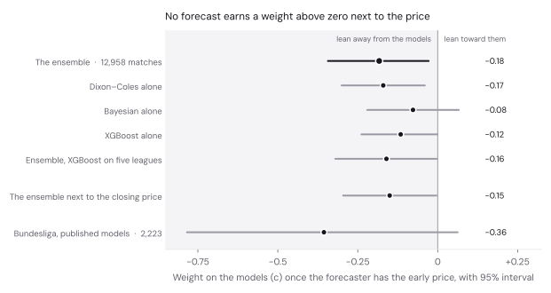
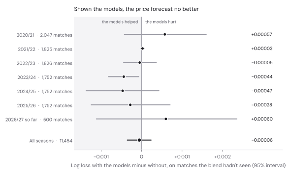
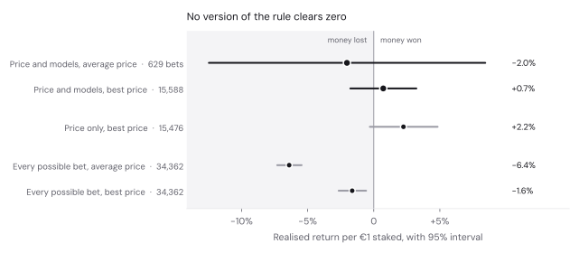

# The price as an input: the models have nothing to add

*19 November 2026. The questions and rules were fixed in [`PREREGISTRATION.md`](PREREGISTRATION.md) before any result was regressed on a price and a forecast together (commit `f5bd041`). Every number below comes from [`results.json`](results.json), written by [`evaluate_blend.py`](../../pipeline/evaluate_blend.py).*

## Verdict

| Question | Rule | Result | Decision |
|---|---|---|---|
| Q1: do the models add information to the early price? | *Information* if the weight on the models is above zero with its whole interval and the blend forecasts unseen matches better with them; *Contrary* if the weight is below zero and it still forecasts better; otherwise *Nothing* | Weight −0.18 (−0.34 to −0.03). Gain on 11,454 unseen matches −0.00006 log loss (−0.00035 to +0.00024) | **Nothing** |
| Q2: does the blend pay the bookmaker's margin? | *Value* if the break-even rule's realised return is above zero with its whole interval at the average early price; *by shopping around* if only at the best price | Average price: 629 bets, −2.0% (−12.5 to +8.4). Best price: 15,588 bets, +0.7% (−1.8 to +3.2) | **No value** |

Nothing on the site changes with this report.

In one paragraph: hand a forecaster the bookmakers' price from a few days before the match, then show it the models as well. The best mix of the two does not lean toward the models. If anything it leans a little away from them, and on matches it had not seen, having the models made no difference at all. What did improve the early price was the price correcting its own habits, and that owes nothing to the models. The match-result market is closed for these models.

## The idea

Every earlier test asked whether the models beat the market. This one asks less: are they any use *next to* it? A second opinion can be worse than the first and still catch something the first missed.

- **The blend.** Each outcome of a match (home, draw, away) gets a score, and the three scores become probabilities that sum to one:

      score = a + b × ln(market probability) + c × ln(model probability)

  `a` is one constant for draws and one for away wins.
- **Price only** fixes `c` at zero. `a` and `b` let the price correct its own habits; `b` above 1 means favourites win more often than the price says.
- **Price and models** lets `c` go. At 0 the models add nothing. Above 0 the best forecast leans toward them. Below 0 it leans away: a model liking a team more than the market does is bad news about that team.
- **Log loss** is the yardstick the blend is fitted on: minus the logarithm of the probability a forecast gave to what happened, averaged over matches. Lower is better. For scale: between Friday's price and the closing price lie 0.0025.
- **Unseen matches.** A weight fitted on the matches it is graded on flatters itself. So each season from 2020/21 is forecast by a blend fitted on earlier seasons only: 11,454 matches the blend had not seen.

Same matches, prices and forecasts as the [closing-line test](../clv/README.md): 12,958 matches in five leagues with the original three-model ensemble, and 2,223 Bundesliga matches with the models the site publishes. Nothing is refitted.

## Q1: the weight on the models



| Blend, fitted on all 12,958 matches | Draw | Away | Market (`b`) | Models (`c`) | Log loss |
|---|---|---|---|---|---|
| The early price as it is | 0 | 0 | 1 | 0 | 0.97194 |
| Price only | +0.10 (+0.05 to +0.16) | +0.05 (+0.00 to +0.10) | 1.12 (1.07 to 1.17) | 0 | 0.97091 |
| Price and models | +0.08 (+0.02 to +0.13) | +0.03 (−0.02 to +0.08) | 1.27 (1.13 to 1.41) | −0.18 (−0.34 to −0.03) | 0.97071 |

- **The weight is below zero.** −0.18, and the whole interval is below zero. Where the models rate a team higher than the price does, the best forecast moves the other way. That fits the closing-line report, where results landed on the far side of the market from the models.
- **It is also tiny.** Even on the matches it was fitted to, the models improve the log loss by 0.0002. The price correcting itself is worth 0.0010, five times as much.
- **In plain numbers.** The single weight `w` in (1 − w) × market + w × models that fits best is −0.28 (−0.39 to −0.16): of every 100 points of disagreement, go 28 the *other* way. This version has no correction for the price's own habits, so part of it is the models' taste for outsiders. `c` is the cleaner number.

### On matches the blend had not seen, it made no difference



- **The gain is nothing.** −0.00006 log loss (−0.00035 to +0.00024); in RPS, −0.00002 (−0.00011 to +0.00007). That is why the verdict is *Nothing* and not *Contrary*: a real contrary signal would have helped here.
- **Why the weight didn't travel.** It isn't stable. Fitted on 2019/20 alone it was +0.20, so the blend went into 2020/21 leaning *toward* the models and did worse for it (+0.00057). By 2025/26 it had drifted to −0.19. Season by season, fitted on each alone, it runs from +0.41 to −0.61, and only 2023/24 and 2024/25 have intervals clear of zero.

| Season | Matches | Weight, fitted on the season alone | Weight the walk-forward blend used | Gain on the season (log loss) |
|---|---|---|---|---|
| 2019/20 | 1,504 | +0.20 (−0.28 to +0.71) | fitting only | |
| 2020/21 | 2,047 | −0.08 (−0.49 to +0.28) | +0.20 | +0.00057 (−0.00042 to +0.00160) |
| 2021/22 | 1,825 | −0.25 (−0.68 to +0.18) | +0.01 | +0.00002 (−0.00002 to +0.00006) |
| 2022/23 | 1,826 | +0.01 (−0.42 to +0.44) | −0.08 | −0.00005 (−0.00044 to +0.00036) |
| 2023/24 | 1,752 | −0.61 (−1.08 to −0.14) | −0.08 | −0.00044 (−0.00082 to −0.00007) |
| 2024/25 | 1,752 | −0.44 (−0.86 to −0.01) | −0.17 | −0.00047 (−0.00137 to +0.00043) |
| 2025/26 | 1,752 | −0.19 (−0.64 to +0.25) | −0.19 | −0.00028 (−0.00124 to +0.00070) |
| 2026/27 so far | 500 | +0.41 (−0.54 to +1.37) | −0.20 | +0.00060 (−0.00112 to +0.00235) |

### Every forecast of the unseen matches, side by side

| Forecast | RPS | Log loss | RPS behind the closing price |
|---|---|---|---|
| The models | 0.2006 | 0.9864 | 0.0055 (0.0047 to 0.0064) |
| The early price as it is | 0.1958 | 0.9711 | 0.0008 (0.0004 to 0.0011) |
| Price only | 0.1957 | 0.9703 | 0.0006 (0.0002 to 0.0010) |
| Price and models | 0.1956 | 0.9703 | 0.0006 (0.0002 to 0.0010) |
| The closing price | 0.1951 | 0.9686 | 0 |

The last two rows before the closing price are the test in miniature. Correcting the price moves it a little. Adding the models to the corrected price moves it in the fifth decimal.

### Where the two blends differ most

All 34,362 outcomes of the unseen matches, in five equal groups by how far the models moved the blend:

| The models moved the blend by | Outcomes | Models said | Price only | Price and models | It happened |
|---|---|---|---|---|---|
| −0.69 points | 6,873 | 37.9% | 36.0% | 35.4% | 35.1% (34.0 to 36.2) |
| −0.13 | 6,872 | 32.0% | 31.6% | 31.5% | 31.8% (30.8 to 32.9) |
| 0.00 | 6,872 | 30.9% | 30.7% | 30.7% | 30.8% (30.1 to 31.5) |
| +0.13 | 6,872 | 30.7% | 31.2% | 31.4% | 32.0% (30.9 to 33.0) |
| +0.69 | 6,873 | 35.1% | 37.0% | 37.7% | 37.0% (35.8 to 38.1) |

The models rarely move the blend by more than a point. In the top row the move was right, in the bottom row it was wrong, and both blends sit inside every interval.

### Cut other ways

- **Each model alone:** Dixon–Coles −0.17 (−0.30 to −0.04), Bayesian −0.08 (−0.22 to +0.07), XGBoost −0.12 (−0.24 to −0.00), the ensemble with XGBoost trained on five leagues −0.16 (−0.32 to −0.00). None gains anything on unseen matches (between −0.00011 and +0.00028, every interval across zero).
- **All three as separate terms:** Dixon–Coles −0.22 (−0.40 to −0.03), Bayesian +0.13 (−0.08 to +0.33), XGBoost −0.07 (−0.21 to +0.06). Unseen gain +0.00012 (−0.00034 to +0.00060): three weights to estimate, slightly worse.
- **Next to the closing price:** −0.15 (−0.30 to −0.00), unseen gain −0.00001 (−0.00031 to +0.00030). The models add nothing at kick-off either.
- **Bundesliga, published models:** −0.36 (−0.78 to +0.06) on 2,223 matches; unseen gain +0.00013 (−0.00226 to +0.00252) on 1,917. Same direction, a sixth of the matches.

| League | Weight on the models | Gain on unseen matches (log loss) |
|---|---|---|
| Bundesliga | −0.51 (−0.93 to −0.10) | +0.00008 (−0.00056 to +0.00076) |
| Premier League | −0.28 (−0.63 to +0.05) | −0.00013 (−0.00080 to +0.00052) |
| La Liga | −0.05 (−0.39 to +0.30) | −0.00019 (−0.00088 to +0.00048) |
| Serie A | −0.09 (−0.45 to +0.28) | −0.00012 (−0.00075 to +0.00052) |
| Ligue 1 | −0.30 (−0.67 to +0.07) | +0.00013 (−0.00057 to +0.00081) |
| **All five** | −0.18 (−0.34 to −0.03) | −0.00006 (−0.00035 to +0.00024) |

Every league's weight is below zero, the Bundesliga's most of all. No league gains anything.

## Q2: the betting rule

€1 on every outcome where the blend's probability × the odds is at least 1, on the 11,454 unseen matches. Realised return decides; closing-line value (CLV) is shown because the site uses it, and the closing-line report explains why it can't be trusted on its own.

| Bets | Number | Average odds | Realised return | CLV | Against other bets at the same odds (points) |
|---|---|---|---|---|---|
| **Price and models**, average early price | 629 | 2.91 | −2.0% (−12.5 to +8.4) | −4.20% | +3.0 (−7.7 to +13.7) |
| Price and models, Bet365's early price | 1,888 | 4.10 | +3.9% (−4.4 to +12.5) | −1.27% | +11.9 (+3.2 to +20.9) |
| **Price and models**, best early price | 15,588 | 4.16 | +0.7% (−1.8 to +3.2) | +1.52% | +3.9 (−0.0 to +8.0) |
| Price only, average early price | 122 | 2.28 | +12.2% (−8.2 to +33.3) | −3.76% | +17.7 (−3.1 to +39.2) |
| Price only, Bet365's early price | 1,466 | 4.38 | +2.8% (−7.1 to +12.7) | −0.61% | +11.2 (+0.7 to +21.3) |
| Price only, best early price | 15,476 | 4.17 | +2.2% (−0.3 to +4.8) | +1.55% | +6.9 (+2.9 to +11.1) |
| Every possible bet, average early price | 34,362 | 3.70 | −6.4% (−7.3 to −5.5) | −4.67% | |
| Every possible bet, best early price | 34,362 | 3.96 | −1.6% (−2.7 to −0.6) | +0.33% | |



- **The verdict is No value.** At the average price the blend finds 629 bets in just over six seasons and loses 2.0% on them, with an interval from −12.5% to +8.4%. At the best price it finds plenty and returns +0.7%, interval across zero.
- **The models take value away.** At the best price, the blend with the models returns +0.7%. The same rule *without* them returns +2.2%. The two place nearly the same bets (15,588 and 15,476); the models' contribution is to pick slightly worse ones.
- **Who the rule bets on:** at the best price, 48% draws, 42% away sides, 10% home sides. That comes from the price-only part of the blend, not from the models. More on it below.
- **Season by season** at the best price: +2.4%, +2.9%, −3.5%, +4.7%, −0.8%, −2.2%, −1.3%. Four of seven below zero, the last three among them.
- **Bundesliga, published models** (the blend fitted on the Bundesliga alone): 1,684 bets at the average price, −4.2% (−13.4 to +5.0); 3,080 at the best price, +1.3% (−5.2 to +7.8).

### Higher bars

| Expected profit at least | Price and models, average price | | Price and models, best price | | Price only, best price | |
|---|---|---|---|---|---|---|
| 0% (the rule) | 629 | −2.0% (−12.5 to +8.4) | 15,588 | +0.7% (−1.8 to +3.2) | 15,476 | +2.2% (−0.3 to +4.8) |
| 2% | 66 | +23.9% (−16.9 to +68.1) | 7,701 | +1.2% (−2.9 to +5.6) | 7,132 | +0.4% (−4.1 to +5.1) |
| 5% | 13 | +52.8% (−75.5 to +202.5) | 1,721 | +7.6% (−4.4 to +20.8) | 1,453 | +7.9% (−6.1 to +23.3) |
| 10% | 2 | too few to say | 299 | +14.5% (−22.9 to +57.4) | 275 | +19.9% (−23.7 to +68.8) |

The returns rise with the bar and the intervals widen faster. No interval clears zero. As agreed beforehand, nothing found in this table becomes a rule.

## What the price-only blend turned up

Reported without a decision, as registered. This is the part of the report with something in it, and none of it is about the models.

- **Favourites win more often than the price says.** `b` = 1.12 (1.07 to 1.17). A price of 75 / 15 / 10 for home, draw and away becomes 77.4 / 14.1 / 8.5; a price of 20 / 23 / 57 becomes 17.6 / 22.7 / 59.7. This is the outsider bias the closing-line report ran into, now measured: it comes from removing the bookmaker's margin proportionally.
- **Home wins are a little overrated.** At the same price, a draw (+0.10, +0.05 to +0.16) or an away win (+0.05, +0.00 to +0.10) comes in more often than a home win.
- **The correction holds on unseen matches.** It improves the early price by 0.00079 log loss (0.00021 to 0.00135). Thirteen times what the models managed, and the only improvement in this report whose interval excludes zero.
- **At the best price it nearly pays.** The price-only rule returned +2.2% (−0.3 to +4.8) on 15,476 bets, and 6.9 points more (+2.9 to +11.1) than other bets at the same odds.

Why that is a lead and not an edge:

- The interval includes zero, and this is one of some forty returns in the report. One of them was always going to look like this.
- The best price means an account with every bookmaker, no stake limits, and prices that may not have been available for real money.
- Germany's 5.3% betting tax alone would turn +2.2% into roughly −3%.
- Higher bars don't sharpen it: +0.4% at 2%, and +7.9% at 5% with an interval from −6% to +23%.

It does say where to look next: the margin-removal test already on the list should treat home, draw and away separately.

## Noticed afterwards (not pre-registered)

- **What the price's correction is worth** (the 0.00079 above). The pre-registration listed both forecasts' scores; their difference with an interval was added after the first results.
- **Home wins are the expensive bet.** Every bet on the unseen matches, by outcome:

  | Outcome | Every bet, average early price | Every bet, best early price | Price-only rule at the best price: bets | Return |
  |---|---|---|---|---|
  | Home win | −8.0% (−10.3 to −5.7) | −4.2% (−6.6 to −1.7) | 838 | +6.3% (−3.1 to +16.4) |
  | Draw | −3.8% (−6.9 to −0.7) | +1.2% (−2.1 to +4.5) | 7,413 | +2.1% (−2.0 to +6.2) |
  | Away win | −7.4% (−10.5 to −4.2) | −1.9% (−5.3 to +1.6) | 7,225 | +1.9% (−2.2 to +6.4) |

  Backing every draw at the best early price roughly broke even. Backing every home side lost 4.2%. The Track record's rule, replayed in the closing-line report, put 63% of its bets on home sides.
- **Examples of the correction** (the 75 / 15 / 10 line above) were computed for this report.

## What this means

- **No rule built on these models can find value in match results.** They lose to the closing price, they lose to the early price, the line ignores them, and now: a forecaster who already has the price learns nothing from being shown them.
- **Don't fade them either.** The weight is below zero on paper, but it changes sign between seasons and is worth nothing on new matches. Same answer as the mirror rule in the closing-line report.
- **The models' place on the site is the story, not the tip.** They explain why a price is what it is. The price is the better forecast.
- **If there is anything in this market, it is in the prices themselves:** which outcomes carry the margin, and which bookmaker is out of line. That needs no model at all.

## Data and checks

- **Written down beforehand, and how it went.**
  - Weight between −0.35 and +0.05, more likely below zero: −0.18. Yes.
  - `b` between 1.00 and 1.15: 1.12 for price only, 1.27 with the models. The prediction didn't say which blend; half right.
  - Gain smaller than 0.0010 either way: −0.00006. Yes.
  - Q1 Nothing or Contrary: Nothing. Q2 No value with fewer than 1,500 bets at the average price: 629. Yes.
- **Recomputed independently.** A second script reads the match tables and the stored forecasts directly, rebuilds the ensemble and fits the blend with a different optimiser (BFGS). It gives the same weights to four decimals (`b` 1.2708, `c` −0.1830), the same unseen gain (−0.000057), the same 629 bets and the same return (−2.03%). Its RPS over all 12,958 matches matches the closing-line report: models 0.2008, early price 0.1963, closing price 0.1955.
- **Runs.** The first run was stopped after ten minutes, before it printed anything; the bootstrap refit was rewritten to run faster (same arithmetic; a test checks it against refitting each resample from scratch). The second run gave every pre-registered number here. A third added the *Noticed afterwards* items and left the others unchanged.
- **Tests.** Ten new tests on made-up matches with known answers ([`test_blend.py`](../../pipeline/tests/test_blend.py)): the fit recovers the weights results were drawn with, the walk-forward never sees the season it forecasts, the rule bets where it should, the verdicts follow the rules.
- **Provenance.** Source data: `source-data` commit `08f400c`. Forecasts: `backtest-results` commit `f18b825`. Both as in the closing-line report.
- **Limits** (as pre-registered):
  - The early price is a Friday or Tuesday afternoon snapshot, not the hour a post goes out.
  - Nobody offers exactly the average price, and the best price assumes accounts everywhere.
  - Germany's 5.3% betting tax and stake limits are ignored; both make real returns worse.
  - The bootstrap treats matches as independent, so the intervals are a little too narrow. Intervals for returns also ignore that the blend's weights were themselves estimated.
  - 2020/21 is forecast from one season of matches.
  - The four new leagues have no xG, so the published models are tested on the Bundesliga only.

## Reproduce

```bash
git fetch origin source-data backtest-results
git worktree add /tmp/source 08f400c         # source-data as this report used it
git worktree add /tmp/results f18b825        # backtest-results as this report graded it
for league in GER ENG ESP ITA FRA; do
  python analysis/pipeline/build_matches.py /tmp/source /tmp/tables/$league.csv --league $league
done
python analysis/pipeline/evaluate_blend.py /tmp/tables /tmp/source /tmp/results/leagues analysis/backtest/blend/results.json \
    --xg-results /tmp/results/xg
python analysis/pipeline/make_blend_figures.py analysis/backtest/blend/results.json analysis/backtest/blend/figs
```

Or open [`blend.ipynb`](blend.ipynb) in Google Colab. It takes about ten minutes on a CPU, nearly all of it the 4,000 refits behind each interval; `RESAMPLES = 400` gives the same picture in two. No model is refitted, so it needs no GPU.

## What happens next

1. **Total goals and handicaps.** Already next on the list, pre-registered separately. The blend is the template: the question there should also be "what do the models add to the price", not "do they beat it".
2. **Margin removal, by outcome.** This report measured the bias (`b` = 1.12, draws +0.10) as a by-product. The planned test should decide which method the site uses and whether the best-price result above survives new matches.
3. **The Track record's paper-betting text.** Two tests now say the same thing about the rule. Still waiting for a decision.
