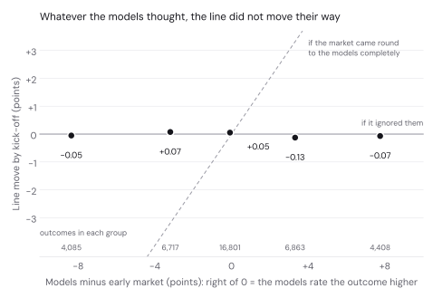
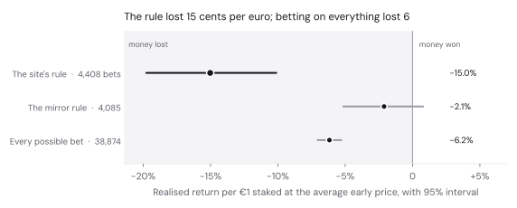
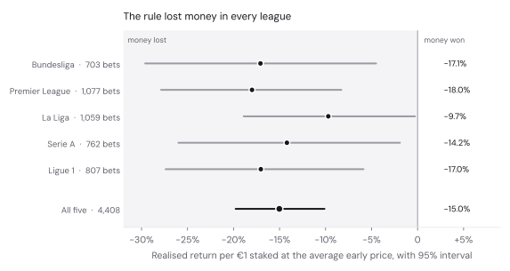

# The closing line: the market never came round to the models

*17 November 2026. The questions and rules were fixed in [`PREREGISTRATION.md`](PREREGISTRATION.md) before any early price was compared with a closing price, a forecast or a result (commit `d5cd317`). Every number below comes from [`results.json`](results.json), written by [`evaluate_clv.py`](../../pipeline/evaluate_clv.py).*

## Verdict

| Question | Rule | Result | Decision |
|---|---|---|---|
| Q1: does the line move toward the models? | None. Expected beforehand: a slope between −0.03 and +0.03 | −0.001 (−0.010 to +0.008) over 12,958 matches | **No. The market ignores them** |
| Q2: does the site's betting rule find value? | *Value* if mean CLV at the average early price is above zero with its whole interval; *Signal* if the line at least moves toward the picks; otherwise *Nothing* | CLV −4.64% (−4.94 to −4.35), line move −0.07 points (−0.15 to +0.01), 4,408 bets | **Nothing** |

Nothing on the site changes with this report.

In one paragraph: the source files hold two prices for every match, one from a few days before and one from kick-off. Had the models known something the early market didn't, prices would have drifted their way by kick-off. They didn't, in any league, at any size of disagreement. The site's paper-betting rule, replayed 4,408 times, paid exactly the bookmaker's margin in closing-line value and lost 15 cents per euro in actual results. Betting on everything blindly lost 6.

## The idea

- **Early price:** football-data.co.uk's odds from Friday afternoon (weekend matches) or Tuesday afternoon (midweek), averaged over the market.
- **Closing price:** the market average at kick-off, the benchmark of every test on this site.
- **Edge:** the ensemble's probability for an outcome minus the early market's.
- **Line move:** the closing probability minus the early one. Prices do move: the home win's probability shifts by 2.1 points on average between the two snapshots.
- **Closing-line value (CLV):** odds taken × closing probability − 1. It asks whether a bet was struck at a better price than the market settled on. Zero is a fair bet if the closing market is right; a bet picked blindly scores about minus the bookmaker's margin, which is 4.9% here.

Two sets of forecasts, nothing refitted: the original three-model ensemble on all five leagues (12,958 matches with an early price), and the models the site publishes on the Bundesliga (2,223).

## Q1: the line does not move toward the models



| Edge the models saw | Outcomes | Models said | Early market | Closing market | It happened | Line move (points) |
|---|---|---|---|---|---|---|
| Models 5+ points below the market | 4,085 | 45.1% | 53.4% | 53.4% | 55.3% | −0.05 (−0.14 to +0.04) |
| 2 to 5 points below | 6,717 | 35.1% | 38.3% | 38.4% | 39.3% | +0.07 (+0.02 to +0.13) |
| Within 2 points | 16,801 | 29.8% | 29.9% | 30.0% | 30.3% | +0.05 (+0.04 to +0.07) |
| 2 to 5 points above | 6,863 | 30.9% | 27.6% | 27.5% | 26.3% | −0.13 (−0.18 to −0.08) |
| Models 5+ points above the market | 4,408 | 36.8% | 29.0% | 29.0% | 26.5% | −0.07 (−0.15 to +0.01) |

- **The slope is zero.** −0.001, with an interval of −0.010 to +0.008. If the models were worth a tenth of the gap, this test would have seen it ten times over.
- **Read the top and bottom rows across.** Where the models were 8 points above the market, the market stayed at 29.0% from Friday to kick-off, and the outcome happened 26.5% of the time. Where they were 8 points below, it stayed at 53.4% and happened 55.3% of the time. The truth lies on the far side of the market from the models, both times.
- **Holding the early price fixed changes nothing** (+0.000, −0.010 to +0.010), so this isn't hidden by favourites shortening or any other drift anyone could see.
- **Per league:** every slope within 0.025 of zero. Serie A's is the only interval that excludes zero (+0.024, +0.001 to +0.046), one in five, and it would close 2% of the gap.
- **Per model:** Dixon–Coles −0.007, Bayesian −0.010 (−0.018 to −0.002), XGBoost +0.011 (+0.004 to +0.018). The last two can be told from zero and are too small to matter: the line closes 1% of XGBoost's gap and widens the Bayesian model's by 1%.
- **Per outcome:** home +0.003, away +0.000, draw −0.030 (−0.039 to −0.020). On draws the line moves a little *away* from the models.
- **Bundesliga, published models:** −0.012 (−0.038 to +0.014).

## Q2: the betting rule

The rule on the Track record: €1 on every outcome the ensemble rates at least 5 points above the market. Here the market is the early one and the bet is struck at the early price.

| Bets | Number | Average odds | CLV | Line move (points) | Realised return |
|---|---|---|---|---|---|
| **The site's rule**, average early price | 4,408 | 4.20 | −4.64% (−4.94 to −4.35) | −0.07 (−0.15 to +0.01) | −15.0% (−19.8 to −10.1) |
| The rule at Bet365's early price | 4,405 | 4.20 | −4.81% (−5.11 to −4.50) | −0.08 (−0.15 to +0.00) | −15.0% (−19.7 to −10.0) |
| The rule at the best early price | 4,408 | 4.54 | +1.25% (+0.89 to +1.61) | −0.07 (−0.15 to +0.01) | −10.0% (−15.1 to −4.7) |
| The mirror rule, average early price | 4,085 | 1.98 | −4.83% (−5.03 to −4.63) | −0.05 (−0.14 to +0.04) | −2.1% (−5.1 to +0.8) |
| Every possible bet, average early price | 38,874 | 3.71 | −4.66% (−4.72 to −4.61) | 0.00 | −6.2% (−7.0 to −5.3) |
| Every possible bet, best early price | 38,874 | 3.97 | +0.39% (+0.32 to +0.47) | 0.00 | −1.3% (−2.3 to −0.3) |



- **The verdict is Nothing.** CLV is below zero, and the line does not move toward the picks. The rule's CLV (−4.64%) is the CLV of betting on everything (−4.66%): the models pick prices no better than a blindfold does.
- **The results are worse than the CLV.** The rule lost 15.0% of stakes, two and a half times what blind betting lost. Its picks were priced at 29.0% by the closing market and came in 26.5% of the time.
- **Who the rule bets on:** 63% home sides, 32% away sides, 5% draws, at average odds of 4.20. It likes outsiders the market doesn't.
- **Every league, every season.** The return is below zero in all five leagues, with the whole interval below zero in each, and in all eight seasons (from −0.2% in 2019/20 to −34.1% in 2023/24).
- **Bundesliga, published models:** 531 bets, CLV −4.73% (−5.56 to −3.90), return −9.5% (−23.4 to +4.6). Same picture on a fifth of the bets.
- **The pooled XGBoost changes nothing:** 4,067 bets, CLV −4.69%, return −13.3%.



| League | Slope (95% interval) | Rule: bets | CLV | Realised return |
|---|---|---|---|---|
| Bundesliga | −0.016 (−0.037 to +0.005) | 703 | −4.91% | −17.1% (−29.6 to −4.5) |
| Premier League | +0.000 (−0.017 to +0.017) | 1,077 | −4.12% | −18.0% (−27.9 to −8.3) |
| La Liga | +0.001 (−0.017 to +0.020) | 1,059 | −4.78% | −9.7% (−18.9 to −0.3) |
| Serie A | +0.024 (+0.001 to +0.046) | 762 | −4.09% | −14.2% (−26.0 to −1.9) |
| Ligue 1 | −0.017 (−0.038 to +0.005) | 807 | −5.40% | −17.0% (−27.4 to −5.9) |
| **All five** | −0.001 (−0.010 to +0.008) | 4,408 | −4.64% | −15.0% (−19.8 to −10.1) |

### The best price was a badly chosen yardstick

At the best early price the rule's CLV is +1.25%, interval above zero. That means nothing: the best price in the market carries almost no margin (0.6%), so *every* bet has positive CLV there (+0.39%), and the same bets still lost 10.0%. The pre-registration used "best-price CLV above zero" as a condition for a forward test under the *Signal* verdict. The verdict is *Nothing*, so the condition never came into play, but it was a poor one and is retired here.

### Other thresholds

| Threshold | Rule: bets | CLV | Return | Mirror: bets | CLV | Return |
|---|---|---|---|---|---|---|
| 0 points | 19,010 | −4.81% | −9.3% (−11.5 to −7.0) | 19,864 | −4.52% | −3.2% (−4.8 to −1.5) |
| 2 points | 11,271 | −4.95% | −13.1% (−16.1 to −10.0) | 10,802 | −4.64% | −2.7% (−4.8 to −0.5) |
| 3 points | 8,420 | −4.89% | −13.5% (−16.9 to −9.9) | 7,613 | −4.70% | −2.3% (−4.6 to +0.1) |
| 5 points | 4,408 | −4.64% | −15.0% (−19.8 to −10.1) | 4,085 | −4.83% | −2.1% (−5.1 to +0.8) |
| 7 points | 2,206 | −4.19% | −14.0% (−20.6 to −7.1) | 2,323 | −5.05% | −0.7% (−4.5 to +2.9) |
| 10 points | 694 | −3.57% | −9.0% (−20.7 to +3.4) | 917 | −5.33% | +4.6% (−1.0 to +10.3) |

No threshold rescues the rule. As agreed beforehand, no threshold found here becomes a rule.

### The mirror rule: are the models a contrary indicator?

Betting *against* the models (on outcomes they rate 5+ points below the market) lost only 2.1%, and the loss shrinks as the disagreement grows. Tempting. But the mirror's picks are mostly favourites at odds around 2, and favourites lose less whoever picks them: every bet at odds below 2 lost 1.9%. The check under *Noticed afterwards* compares like with like and finds no edge in fading the models.

## Noticed afterwards (not pre-registered)

- **Against other bets at the same odds.** Splitting all bets into 20 groups by price and comparing each pick with the other bets in its group:
  - the rule's picks returned 8.4 points *less* (−13.8 to −2.9). The models' enthusiasm is bad news about a bet, not just noise;
  - the mirror's picks returned 1.5 points more (−2.1 to +4.8). Indistinguishable from nothing. Don't fade the models either.
- **CLV saw a third of the damage.** By CLV the rule looked harmless (−4.6%, same as blind betting). By results it lost 15.0%. Two reasons, both already on the books: removing the margin proportionally flatters outsiders (bets at odds above 4 win 16.1% of the time against a closing 17.2%), and results go past the closing line, away from the models. So CLV as the site computes it tells you the direction and understates the size. The margin-removal test moves up the list.
- **Most of the gap is already in Friday's price.** RPS over these matches: models 0.2008, early market 0.1963, closing market 0.1955. The models trail Friday's price by 0.0045 (0.0038 to 0.0052); the last days before kick-off add 0.0007 (0.0004 to 0.0011). The four-league report blamed the gap on a market "that also knows who is injured". Whatever the market knows, it knows most of it by Friday, so line-ups on the day are the small part.

## What this means

- **There is no edge in the match-result market from these models.** Not at the closing price (the four-league test), not at the early price (this one), not at 5 points, not at any other threshold, not by doing the opposite.
- **The paper-betting rule would have lost money in every league.** The ledger still runs as registered, so nobody can say the losers were deleted. What the Track record says about it is the follow-up.
- **A model that likes a team more than the market does is still not a tip.** The four-league report said so about the closing price. It holds three days earlier too.

## Data and checks

- **Coverage.** 12,959 test matches; 12,958 have the early average and the best price, 12,954 Bet365's. One Serie A match has no early price and is left out throughout.
- **Written down beforehand, and how it went.** Slope inside −0.03 to +0.03: yes. Verdict Nothing or Signal: Nothing. CLV between −8% and −3%: −4.64%. Realised return below zero: yes, and further below than expected.
- **Recomputed independently.** A second script, reading the source files and the stored forecasts directly without the pipeline's match tables, gives the same slope (−0.00076), the same 4,408 bets, the same CLV (−4.637%) and the same return (−15.03%).
- **The best early price** isn't in the match tables. It is read from the source files by each row's file and line; the reader was checked against a second parser on all 83,580 rows of the five tables.
- **Tests.** Nine new tests on made-up matches with known answers ([`test_clv.py`](../../pipeline/tests/test_clv.py)).
- **Provenance.** Source data: `source-data` commit `08f400c`. Forecasts: `backtest-results` commit `f18b825` (`leagues/` unchanged since `7124cc7`, `xg/` as the Track record uses it).
- **Limits** (as pre-registered):
  - The early price is a Friday or Tuesday afternoon snapshot, not the hour a post goes out.
  - Nobody offers exactly the average price. Bet365's own early price gives the same answer.
  - Germany's 5.3% betting tax and stake limits are ignored; both make real returns worse.
  - The bootstrap treats matches as independent, so the intervals are a little too narrow.
  - The four new leagues have no xG, so the published models are tested on the Bundesliga only.

## Reproduce

```bash
git fetch origin source-data backtest-results
git worktree add /tmp/source 08f400c         # source-data as this report used it
git worktree add /tmp/results f18b825        # backtest-results as this report graded it
for league in GER ENG ESP ITA FRA; do
  python analysis/pipeline/build_matches.py /tmp/source /tmp/tables/$league.csv --league $league
done
python analysis/pipeline/evaluate_clv.py /tmp/tables /tmp/source /tmp/results/leagues analysis/backtest/clv/results.json \
    --xg-results /tmp/results/xg
python analysis/pipeline/make_clv_figures.py analysis/backtest/clv/results.json analysis/backtest/clv/figs
```

Or open [`clv.ipynb`](clv.ipynb) in Google Colab: it rebuilds the tables, grades every bet and draws the charts in about two minutes. No model is refitted, so it needs no GPU; the forecasts are the published ones, and [`leagues.ipynb`](../leagues/leagues.ipynb) refits them.

## What happens next

1. **The Track record's paper-betting text** should say what this test found. That is a change to the site and waits for a decision.
2. **Total goals and handicaps.** The same files carry early and closing prices for over/under 2.5 goals and the Asian handicap, and the models already produce score grids. Pre-registered separately.
3. **Margin removal.** Now more than a footnote: it decides how much CLV can be trusted as the site's betting measure.
4. **A calibration layer** for the models, fitted on five leagues.
