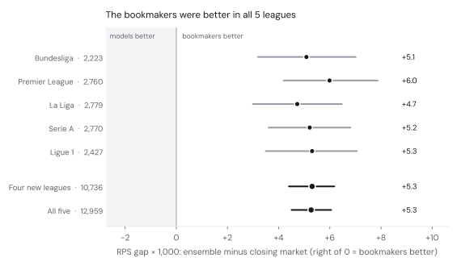
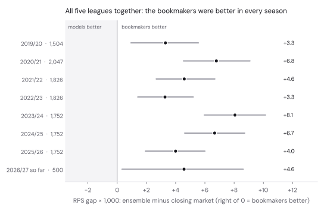
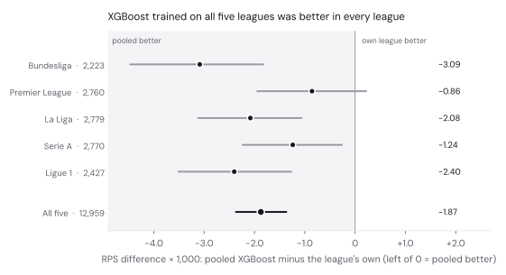
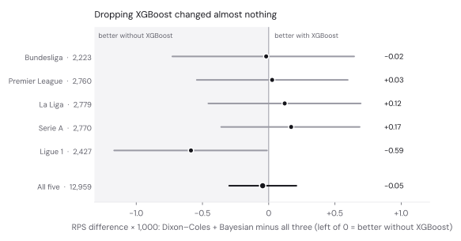

# Four more leagues: the same gap, and a better XGBoost

*16 November 2026. The questions, models and decision rules were fixed in [`PREREGISTRATION.md`](PREREGISTRATION.md) before any model ran on English, Spanish, Italian or French matches (commit `74f049d`). Every number below comes from [`results.json`](results.json), written by [`evaluate_leagues.py`](../../pipeline/evaluate_leagues.py).*

## Verdict

| Question | Rule | Result | Decision |
|---|---|---|---|
| Q1: are the models as far behind the bookmakers elsewhere? | None. Expected beforehand: bookmakers ahead in every league, gap in the four new leagues between 0.003 and 0.008 | +0.0053 RPS (+0.0044 to +0.0062) over 10,736 matches; bookmakers ahead in all five leagues | **Yes. The Bundesliga result carries over** |
| Q2: does XGBoost forecast the Bundesliga better when trained on all five leagues? | Switch if the xG ensemble with pooled XGBoost minus the published xG ensemble is below zero, with the whole 95% interval below zero | −0.00048 (−0.00088 to −0.00008) | **Switch to the pooled XGBoost** (in a follow-up change) |
| Q3: does XGBoost earn its place? | Drop it if two models beat three over all five leagues with the whole interval below zero, and also in the Bundesliga's xG models | −0.00005 (−0.00030 to +0.00021); Bundesliga +0.00032 | **Keep XGBoost** |

Nothing on the site changes with this report. The Q2 switch touches the published forecasts, so it comes as its own change.

## Q1: the gap travels

The Bundesliga backtest said the closing odds beat the models by 0.0053 RPS. That was one league and about 2,200 matches. The same models, with nothing retuned, now have 10,736 matches in four leagues they had never seen:



| League | Matches | Bookmakers | Ensemble | Gap (95% interval) |
|---|---|---|---|---|
| Bundesliga | 2,223 | 0.1980 | 0.2031 | +0.0051 (+0.0032 to +0.0070) |
| Premier League | 2,760 | 0.1970 | 0.2030 | +0.0060 (+0.0042 to +0.0079) |
| La Liga | 2,779 | 0.1917 | 0.1964 | +0.0047 (+0.0030 to +0.0065) |
| Serie A | 2,770 | 0.1906 | 0.1958 | +0.0052 (+0.0036 to +0.0068) |
| Ligue 1 | 2,427 | 0.2016 | 0.2069 | +0.0053 (+0.0035 to +0.0071) |
| Four new leagues | 10,736 | 0.1950 | 0.2003 | +0.0053 (+0.0044 to +0.0062) |
| **All five** | 12,959 | 0.1955 | 0.2008 | +0.0053 (+0.0045 to +0.0061) |

- **Same size everywhere.** Five leagues, five gaps between 0.0047 and 0.0060. Every interval excludes zero.
- **A much sharper number.** With all five leagues the interval is less than half as wide as the Bundesliga's alone (±0.0008 against ±0.0019).
- **Every season.** Taking the five leagues together, the bookmakers were better in each of the eight seasons, and each season's interval excludes zero.
- **Against coin-flipping.** One-third for everything scores 0.2359 on these matches and the market 0.1955. The ensemble gets 87% of the way, as in the Bundesliga.



So the gap isn't a Bundesliga quirk or an unlucky sample. It is what these three models, fed results and shots, are worth against a market that also knows who is injured.

## Q2: XGBoost with five times the data

XGBoost was the weakest of the three models in every league. It has 30 features and, for the Bundesliga, about 3,400 matches to learn from in 2019. The pooled version learns from all five top flights at once, about 20,000 matches, with the same features and settings plus a marker for the league.



| League | Own XGBoost | Pooled XGBoost | Difference (95% interval) | Effect on the ensemble |
|---|---|---|---|---|
| Bundesliga | 0.2057 | 0.2027 | −0.00309 (−0.00447 to −0.00182) | −0.00081 (−0.00127 to −0.00039) |
| Premier League | 0.2052 | 0.2044 | −0.00086 (−0.00194 to +0.00022) | −0.00026 (−0.00062 to +0.00010) |
| La Liga | 0.1985 | 0.1964 | −0.00208 (−0.00312 to −0.00106) | −0.00051 (−0.00085 to −0.00017) |
| Serie A | 0.1974 | 0.1962 | −0.00124 (−0.00224 to −0.00026) | −0.00027 (−0.00061 to +0.00006) |
| Ligue 1 | 0.2100 | 0.2076 | −0.00240 (−0.00351 to −0.00127) | −0.00066 (−0.00103 to −0.00028) |
| **All five** | 0.2031 | 0.2012 | −0.00187 (−0.00237 to −0.00137) | −0.00049 (−0.00065 to −0.00032) |

- **Better in every league,** clearly so in four. The Bundesliga gains most. It is the smallest league (306 matches a season against 380), so its own model was the hungriest.
- **From last to first.** With the original models in the Bundesliga, pooled XGBoost (0.2027) beats Dixon–Coles (0.2032), the Bayesian model (0.2036) and the three-model ensemble (0.2031).
- **The league marker matters little.** Without it the gain over all five is −0.00186 (−0.00239 to −0.00134).

### The rule, on the Bundesliga's xG models

The site runs the xG versions, so the rule was written for them: the same 2,187 matches as the xG test, Dixon–Coles-xG and Bayesian-xG as published, and only XGBoost-xG swapped.

| | Published | With pooled XGBoost-xG |
|---|---|---|
| XGBoost-xG alone | 0.2050 | 0.2032 |
| xG ensemble | 0.2024 | 0.2019 |
| Gap to the bookmakers (0.1980) | +0.0044 (+0.0026 to +0.0062) | +0.0039 (+0.0022 to +0.0056) |

The ensemble difference is −0.00048 (−0.00088 to −0.00008): below zero, the whole interval below zero, and nearly five times the noise floor of 0.0001. **The rule says switch.**

How much weight to put on it:

- **It is a narrow pass.** The interval's upper end is close to zero. The variant without the league marker, reported but not part of the rule, comes out at −0.00038 (−0.00078 to +0.00004) and would not have passed.
- **It is about half of what xG brought** (−0.00092). Together, xG and pooling take the gap to the market from 0.0053 to 0.0039: about a quarter closed.
- **By season:** better in five of the seven full seasons, worse in 2022/23 and 2023/24. Only 2019/20 clears zero on its own.

| Season | Matches | Difference × 1,000 (95% interval) |
|---|---|---|
| 2019/20 | 306 | −2.09 (−3.32 to −0.82) |
| 2020/21 | 306 | −0.98 (−2.06 to +0.13) |
| 2021/22 | 306 | −0.75 (−1.77 to +0.26) |
| 2022/23 | 306 | +0.34 (−0.86 to +1.58) |
| 2023/24 | 306 | +0.75 (−0.26 to +1.81) |
| 2024/25 | 306 | −0.26 (−1.29 to +0.77) |
| 2025/26 | 306 | −0.37 (−1.25 to +0.55) |
| 2026/27 so far | 45 | −0.57 (−3.75 to +2.80) |

The direction is the same in all five leagues and in both variants, which is the stronger argument than the Bundesliga interval alone.

## Q3: XGBoost keeps its place



Over all five leagues, Dixon–Coles plus the Bayesian model against all three comes to −0.00005 (−0.00030 to +0.00021): nothing, and measured almost three times as precisely as in one league. The Bundesliga's xG models with the pooled XGBoost are, if anything, better with it (+0.00032, −0.00028 to +0.00091). Both conditions for dropping it fail. Only Ligue 1 on its own would have preferred two models (−0.00059, −0.00117 to −0.00001).

## Each model

| League | Dixon–Coles | Bayesian | XGBoost | XGBoost, pooled | Ensemble | Bookmakers | Time decay |
|---|---|---|---|---|---|---|---|
| Bundesliga | 0.2032 | 0.2036 | 0.2057 | 0.2027 | 0.2031 | 0.1980 | 0.0019 |
| Premier League | 0.2038 | 0.2031 | 0.2052 | 0.2044 | 0.2030 | 0.1970 | 0.0028 |
| La Liga | 0.1968 | 0.1968 | 0.1985 | 0.1964 | 0.1964 | 0.1917 | 0.0019 |
| Serie A | 0.1959 | 0.1971 | 0.1974 | 0.1962 | 0.1958 | 0.1906 | 0.0028 |
| Ligue 1 | 0.2073 | 0.2068 | 0.2100 | 0.2076 | 0.2069 | 0.2016 | 0.0040 |
| **All five** | 0.2012 | 0.2013 | 0.2031 | 0.2012 | 0.2008 | 0.1955 | |

Dixon–Coles and the Bayesian model are level over 12,959 matches (0.2012 and 0.2013). The ensemble beats each of them in every league but one (Ligue 1, where the Bayesian model is a hair ahead), which is the case for averaging.

## When the models and the market disagree

In the Bundesliga, whenever the models and the market differed on the favourite, reality sided with the market and then went a step further. With five leagues:

| Models v market on the favourite | Matches | Models said | Market said | Favourite won |
|---|---|---|---|---|
| Models 7+ points less sure | 2,629 | 48.4% | 59.0% | 61.8% |
| Models 3–7 points less sure | 3,011 | 49.9% | 54.8% | 57.1% |
| Within 3 points | 4,816 | 50.5% | 50.7% | 52.1% |
| Models 3+ points more sure | 2,503 | 53.1% | 46.6% | 46.1% |

Same picture, five times the matches. A model that likes a team more than the market does is not a tip. This is why the site grades its paper bets on closing-line value and not on the models' opinion of themselves.

## Noticed afterwards (not pre-registered)

- **Favourites.** In the four new leagues the market's favourite won 54.2% of the time, against 52.4% implied by the closing odds with the margin removed proportionally. In the Bundesliga the two agree (53.4% both). That is the favourite–longshot bias: bookmakers load more of their margin onto outsiders, so removing it evenly undersells favourites. It suggests the benchmark would be a little stronger still with a better margin removal. Worth its own pre-registered test; nothing here rests on it.

## Data and checks

- **Everything forecast.** All 12,959 matches have forecasts from all three models; none left out.
- **Reproduced on the way.**
  - Germany's Dixon–Coles and XGBoost forecasts for the 2,187 matches of the October backtest are identical to the published ones, number for number.
  - The pooled job's refit of each league's own XGBoost matches the backtest's exactly in all five leagues, and its refit of XGBoost-xG matches the published xG backtest exactly. Only the training set differs between the two sides of Q2.
  - The pooled XGBoost-xG forecasts are identical on a second machine.
- **Sampler.** 367 Bayesian refits. Divergent transitions per league: Germany 117, England 39, Spain 201, Italy 161, France 188, each out of about 36,000 draws.
- **Provenance.**
  - Predictions: `backtest-results` commit `7124cc7` (`leagues/`, workflow run 43925210075, code `4c1d3fb`).
  - Source data: `source-data` commit `08f400c`.
  - Published xG predictions: `xg/` as of commit `15e0402`.
  - Understat files: as fetched on 26 October 2026, with football-data.co.uk's xG for the 18 matches since.
- **Limits** (as pre-registered):
  - The four new leagues have no xG, so they test the original models. The Q2 rule was applied to the xG versions in the Bundesliga only.
  - England, Spain and Italy played the end of 2019/20 in July and August 2020. The pipeline counts those 221 matches as 2020/21, which is why 2019/20 looks short and 2020/21 long in the season chart.
  - The closed-doors window is Germany's; the other leagues' dates differ by a few weeks.
  - The bootstrap treats matches as independent, so the intervals are a little too narrow.

## Reproduce

```bash
git fetch origin source-data backtest-results
git worktree add /tmp/source origin/source-data
git worktree add /tmp/results origin/backtest-results
git clone https://github.com/JHvL88/matchday-data /tmp/matchday-data      # private: needs your GitHub login
for league in GER ENG ESP ITA FRA; do
  python analysis/pipeline/build_matches.py /tmp/source /tmp/tables/$league.csv --league $league
done
python analysis/pipeline/build_matches.py /tmp/source /tmp/GER_xg.csv --understat /tmp/matchday-data/understat
python analysis/pipeline/evaluate_leagues.py /tmp/tables /tmp/results/leagues analysis/backtest/leagues/results.json \
    --xg-table /tmp/GER_xg.csv --xg-results /tmp/results/xg
python analysis/pipeline/make_league_figures.py analysis/backtest/leagues/results.json analysis/backtest/leagues/figs
```

Or open [`leagues.ipynb`](leagues.ipynb) in Google Colab: it rebuilds the tables, refits the pooled XGBoost (on a GPU if there is one), grades everything and draws the charts in about ten minutes, with switches to refit the other models too.

To rerun the models themselves on GitHub: Actions › **Backtest (leagues)** › Run workflow (about 50 jobs, an hour and a half).

## What happens next

1. **Make the Q2 switch.** `forecast.py` trains XGBoost-xG on all five leagues, the xG backtest is rerun with it, and the Track record follows.
2. **xG for the other four leagues** once Understat is back. Pooled XGBoost currently sees xG only for German matches.
3. **Test the margin removal** (the favourites note above).
