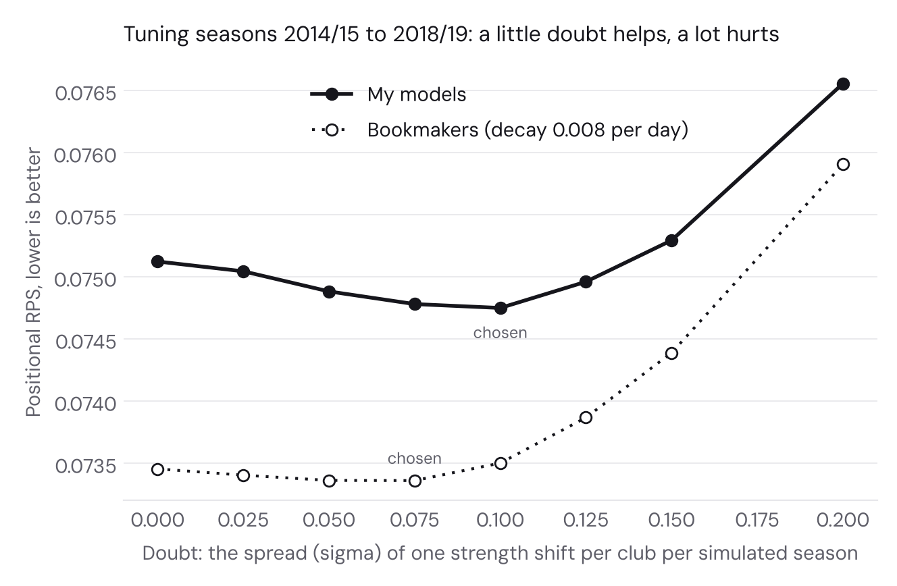
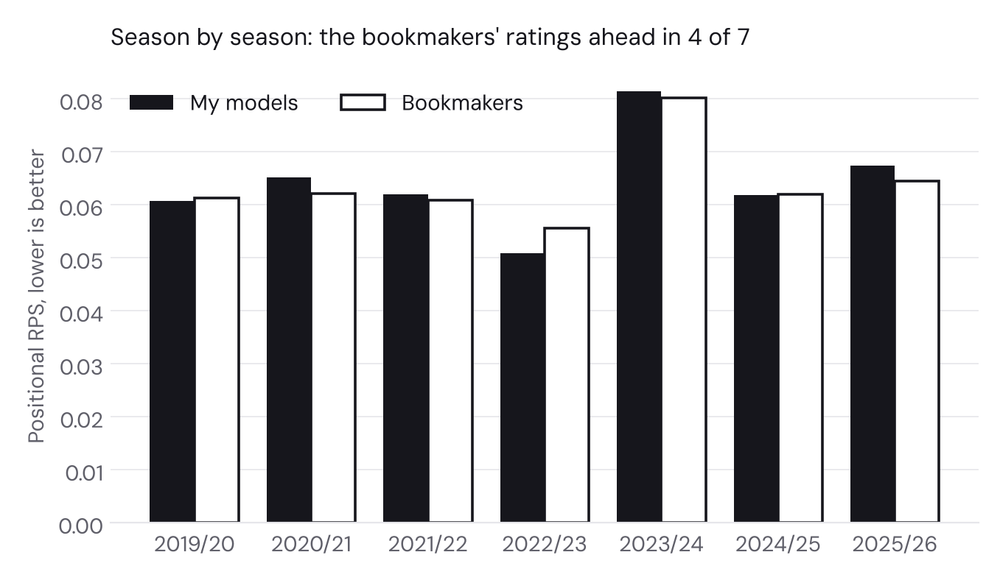
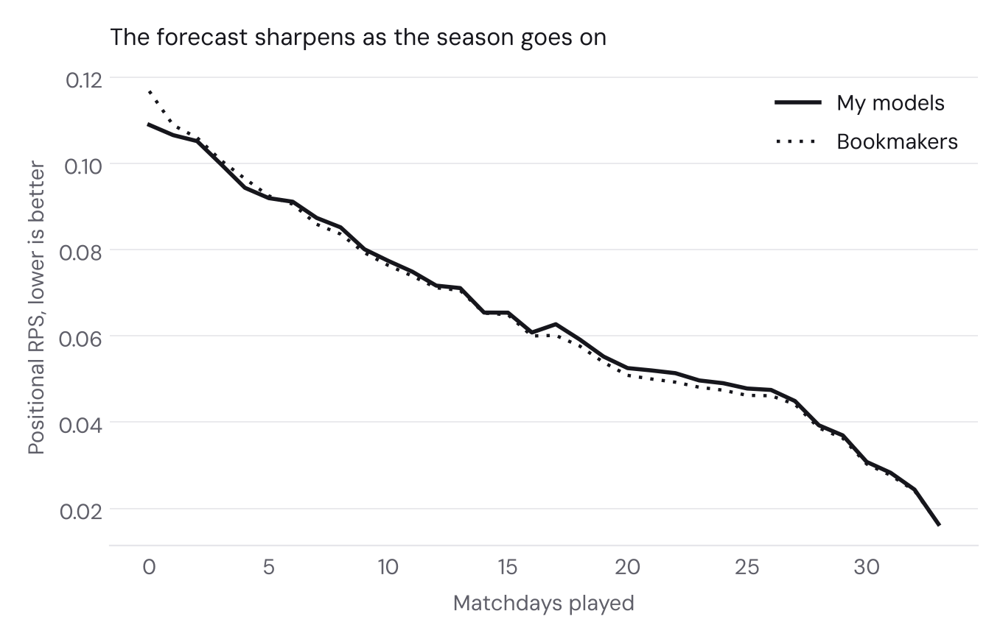
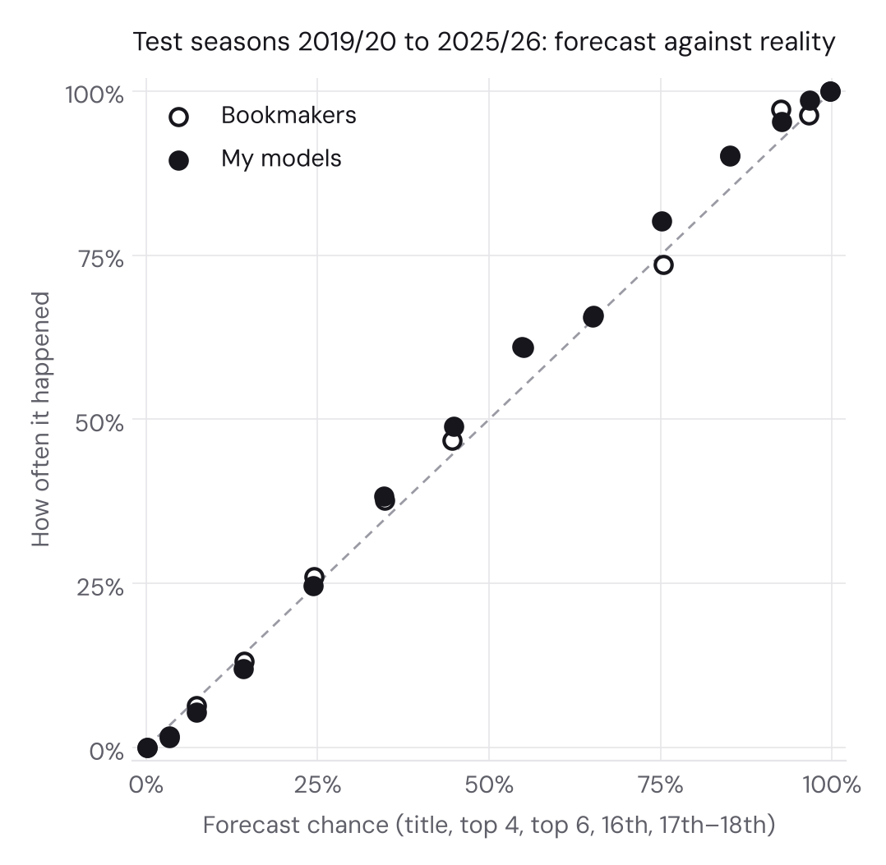

# The season simulator: does it know how a season ends?

*Pre-registered in [PREREGISTRATION.md](PREREGISTRATION.md) (commit `05f3e4f`, 18 November 2026) before
any past season was scored. Run the same evening. Code: `analysis/pipeline/season_sim.py` (the
simulator), `season_backtest.py` (this test), `make_season_figures.py` (the charts). Numbers:
[results.json](results.json). Notebook: [season.ipynb](season.ipynb).*

## Verdict

- **Both versions forecast final positions far better than the table does.** Positional RPS on the
  seven test seasons (2019/20 to 2025/26, lower is better): my models **0.0642**, the bookmakers'
  ratings **0.0638**, the table as it stands 0.1096, guessing 0.1759.
- **Neither is clearly better.** The bookmakers' ratings were ahead overall and in 4 of the 7 test
  seasons; the rule needed 5. The page says so.
- **A little doubt helps.** Tuning chose σ = 0.10 for my models and 0.075 for the bookmakers'. On the
  test seasons the doubt beat no doubt for both (0.0642 v 0.0644; 0.0638 v 0.0640): small, same direction.
- **Not perfectly calibrated, and wrong in one direction.** Both pass most bands, but both are too
  cautious about strong chances: my models' 75% came true 80% of the time, 85% came true 90%. The page
  may not call it "well calibrated" (decision rule 3) and says where it misses instead.

## Settings chosen on the tuning seasons (2014/15 to 2018/19)



| | σ | Market decay ξ | Positional RPS |
|---|---|---|---|
| My models | **0.10** | – | 0.07475 |
| Bookmakers' ratings | **0.075** | **0.008** per day | 0.07336 |
| no doubt (σ = 0) | 0 | (0.008) | 0.07512 / 0.07345 |
| The table as it stands | | | 0.1277 |

Neither σ is at the edge of its grid. **ξ = 0.008 is the fastest decay on the grid** (a half-life of
about three months): the market's own ratings are most useful when they lean on its latest prices. The
pre-registration only foresaw the edge case for σ; the ξ grid was not widened after seeing this, so a
faster decay might do a little better.

## Test seasons (2019/20 to 2025/26)

| | 2019/20 | 2020/21 | 2021/22 | 2022/23 | 2023/24 | 2024/25 | 2025/26 | **All** |
|---|---|---|---|---|---|---|---|---|
| My models | **0.0608** | 0.0652 | 0.0620 | **0.0508** | 0.0815 | **0.0619** | 0.0675 | 0.0642 |
| Bookmakers' ratings | 0.0613 | **0.0621** | **0.0609** | 0.0556 | **0.0802** | 0.0620 | **0.0645** | **0.0638** |
| Table as it stands | 0.1145 | 0.1071 | 0.0994 | 0.1319 | 0.0990 | 0.0996 | 0.1155 | 0.1096 |



2023/24 was the hardest season for both: Leverkusen started it at 3% for the title in my models' version.

**Through the season.** Before kick-off the error is 0.109, after matchday 33 it is 0.016. By stage
(checkpoints 0–11 / 12–22 / 23–33): my models 0.092 / 0.061 / 0.038; the bookmakers' 0.093 / 0.059 / 0.037.
The market gains on the models from the middle of the season on.



**Brier scores** (lower is better), my models v the bookmakers' ratings: title 0.0091 v 0.0085, top four
0.0491 v 0.0466, top six 0.0646 v 0.0659, 16th 0.0462 v 0.0465, 17th–18th 0.0459 v 0.0467.

## Calibration



All five outcomes pooled (title, top four, top six, 16th, 17th–18th), 34 checkpoints × 18 clubs × 7
seasons. Bands that failed the pre-registered check (outside the 95% binomial interval and more than 3
points off, at least 100 forecasts):

| Version | Forecast | Happened |
|---|---|---|
| My models | 55% | 61% |
| My models | 75% | 80% |
| My models | 85% | 90% |
| Bookmakers' ratings | 85% | 90% |
| Bookmakers' ratings | 93% | 97% |

Every miss is on the cautious side.

*Looked at afterwards, not pre-registered:* the doubt is what tips the top bands over. Without it the same
forecasts lean the other way: my models' 75% band came true 72% of the time and the 85% band 83% (with
doubt: 80% and 90%). So the right amount of doubt for strong chances is smaller than the amount that
scores best overall. A doubt that shrinks as the season goes on, or one per outcome, would be the
natural next test; nothing on the site changes because of this.

*Not pre-registered, a caution about the check itself:* the same club appears at 34 checkpoints of the
same season, so the forecasts in a band are far from independent and the binomial intervals are too
narrow. Read the check as strict, not as proof of a problem.

## Past seasons, as the simulator saw them

The site's replays (`data/season_replays.json`) use exactly these runs: every club, every checkpoint,
both versions, with the chosen settings. The tuning seasons are in-sample for σ and ξ only. Two that
stand out:

- **2022/23.** Going into the final day my models gave Dortmund 80% for the title (bookmakers' ratings
  73%). Bayern won it in the 89th minute in Cologne.
- **2023/24.** Leverkusen: 3% before kick-off, 13% after matchday 10, favourites for good after
  matchday 21 and past 90% after matchday 26. Bayern had peaked at 81% after matchday 13.

## Checks

- No final table in the twelve seasons had two clubs level on points, goal difference and goals, so the
  random tie-break never decided an outcome here.
- The sampler draws Dixon–Coles scorelines exactly (tests compare it with the score grid), and the
  browser's engine (`season/sim.js`) agrees with the Python one within simulation noise
  (`analysis/pipeline/tests/test_season.py`).
- The site's numbers for 2026/27 after matchday 9 came out identical on GitHub Actions and on a laptop
  (Bayern 86.9% in my models' version, 91.7% in the bookmakers').

## Reproduce

```bash
python analysis/pipeline/build_matches.py source /tmp/matches.csv --understat matchday-data/understat
python analysis/pipeline/season_backtest.py run /tmp/matches.csv /tmp/season-bt --phase tune     # ~17 min, 2 cores
python analysis/pipeline/season_backtest.py choose /tmp/matches.csv /tmp/season-bt
python analysis/pipeline/season_backtest.py run /tmp/matches.csv /tmp/season-bt --phase test     # ~6 min
python analysis/pipeline/season_backtest.py grade /tmp/matches.csv /tmp/season-bt analysis/backtest/season/results.json \
    --site data/season_test.json --replays data/season_replays.json --openligadb-dir openligadb/
python analysis/pipeline/make_season_figures.py analysis/backtest/season/results.json analysis/backtest/season/figs
```

Source data: `source-data` commit `08f400c`; Understat files at `matchday-data` commit `b05a285`.
Without the private Understat files, my models' ratings learn from goals only; the bookmakers' ratings
need nothing private.
