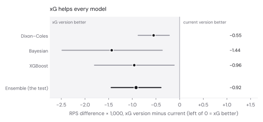
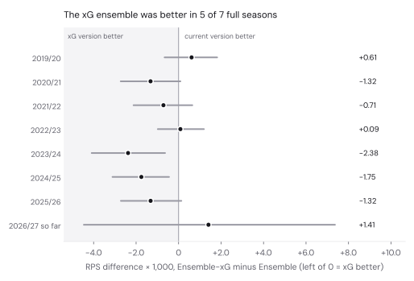

# Does xG make the models better? Yes, a little.

*16 October 2026. The questions, models and decision rules were fixed in [`PREREGISTRATION.md`](PREREGISTRATION.md) before anything ran (commit `600bdaa`, 21:40). Every number below comes from [`results.json`](results.json) (xG versions against the current models) and [`results_vs_market.json`](results_vs_market.json) (xG versions against the bookmakers).*

## Verdict

| Question | Rule | Result | Decision |
|---|---|---|---|
| Q1: do the models forecast better with xG? | Adopt if Ensemble-xG minus Ensemble is below zero, with the whole 95% interval below zero | −0.00092 RPS (−0.00145 to −0.00039) | **Adopt the xG versions** |
| Q2: does XGBoost earn its place? | Drop it if Dixon–Coles + Bayesian beats all three, with the whole interval below zero | −0.00016 (−0.00080 to +0.00046) | **Keep XGBoost** |

The published models are now the xG versions. The Track record page shows their backtest.

## How big is the improvement?

**Small, real, and not enough to beat the bookmakers.**

- **Size against the gap.** Over the same 2,187 matches (2019/20 to matchday 5 of 2026/27), the ensemble's RPS drops from 0.2033 to 0.2024. The bookmakers' closing odds score 0.1980, so the gap to the market shrinks from 0.0053 to 0.0044 (95% interval 0.0026 to 0.0062). xG closes about a sixth of it.
- **Size against coin-flipping.** Measured from one-third-for-everything (0.2367) to the market, the models now get 89% of the way instead of 86%.
- **Size against the noise.** The improvement is about twenty times the run-to-run noise of the Bayesian model (±0.00005 on the ensemble).
- **How often.** The xG ensemble beat the current one on 54% of individual matches, and in 5 of the 7 full seasons. It was slightly worse in 2019/20 (+0.0006) and 2022/23 (+0.0001); neither interval excludes zero.
- **This season.** The 45 matches of 2026/27 so far also show the xG ensemble slightly worse (+0.0014, interval −0.0045 to +0.0074), which is noise at that sample size. It still beats the market there: 0.2073 against 0.2131.

## Each model

| Model | Current RPS | xG RPS | Difference (95% interval) | Log loss, current → xG |
|---|---|---|---|---|
| Dixon–Coles | 0.2035 | 0.2029 | −0.00055 (−0.00088 to −0.00022) | 0.9920 → 0.9902 |
| Bayesian shots-to-goals | 0.2038 | 0.2024 | −0.00144 (−0.00248 to −0.00037) | 0.9944 → 0.9905 |
| XGBoost | 0.2060 | 0.2050 | −0.00096 (−0.00180 to −0.00012) | 0.9997 → 0.9970 |
| **Ensemble** | **0.2033** | **0.2024** | **−0.00092 (−0.00145 to −0.00039)** | 0.9918 → 0.9890 |
| Bookmakers (closing average) | 0.1980 | | | 0.9743 |

- **Dixon–Coles.** Its pre-registered tuning on 2018/19 chose a blend of a quarter xG and three quarters goals (RPS 0.20119; goals only 0.20127; xG only 0.20235). Pure xG was clearly worse, so goals still carry information xG misses: finishing, goalkeeping, penalties.
- **Bayesian.** It gains the most. Treating xG as a second view of chance creation gives the team strengths more evidence each week. On its own it now matches the whole ensemble (0.20239 against 0.20240). It also cured the sampler: 0 divergent transitions in 71 monthly refits, against 150 for the current model.
- **Top-pick rate.** It moved slightly the wrong way for the ensemble, 51.9% → 51.4%. RPS and log loss both improved, and they judge the whole probability rather than the favourite alone, which is what matters for odds. Reported as found.
- **Q2.** Without XGBoost the xG ensemble would score 0.2022 instead of 0.2024. That's not a clear enough difference to drop it under the rule, so XGBoost stays.

## When the models disagree with the market

The pattern from the original backtest holds with xG (market's favourite, xG ensemble):

| Models compared with the market | Matches | Models said | Market said | Favourite won |
|---|---|---|---|---|
| 7+ points less sure | 377 | 51.1% | 61.4% | 64.2% |
| 3–7 points less sure | 500 | 50.9% | 55.6% | 56.8% |
| Within 3 points | 892 | 50.9% | 51.1% | 50.3% |
| 3+ points more sure | 418 | 54.5% | 48.3% | 45.7% |

Disagreements are fewer than before (377 big ones instead of 467), but reality still goes past the market, away from the models. xG makes the models closer to the market, not cleverer than it.

## Data and checks

- **xG source.** Understat match xG for every 1. Bundesliga match since 2014/15. All 3,717 matches join to the match table; the only score difference is Union v Bochum (Dec 2024, awarded 0–2 against 1–1 on the pitch). The raw files are in the private data repo; [`understat_manifest.json`](understat_manifest.json) lists their checksums.
- **Current models unchanged.** The xG versions are opt-in switches. A full rerun of the current models on the new code reproduced Dixon–Coles and XGBoost exactly. The Bayesian model differed only by machine-to-machine sampling noise (ensemble +0.000007, interval −0.00004 to +0.00006).
- **Reproduced.** The Colab notebook [`../backtest.ipynb`](../backtest.ipynb) rebuilds the xG backtest from scratch and gives identical figures, with the published Bayesian predictions or `RUN_BAYES = True`.
- **Provenance.**
  - xG predictions: `backtest-results` commit `46e623d` (`xg/`, workflow run 38957575663, code `9075a99`).
  - Current models' predictions: commit `eee9da5`.
  - Source data: `source-data` commit `e47f4cf`.
  - Understat: data-repo commit `dcb44f9`.
- **Caveats** (as pre-registered):
  - Understat's xG for old matches may come from a later version of its model.
  - Understat is a single, lightly documented provider.
  - Promoted clubs arrive without xG history.

## Found along the way

- **A workflow bug.** Two fetch workflows piped their download through `tee`. GitHub's default shell doesn't use `pipefail`, so a failed download looked like a success. Both now fail properly and refuse to commit a partial download. The football-data files were never affected: all 54 were always present.
- **Understat compression.** Understat's data endpoint returns gzip-compressed JSON whether or not it's asked to. The fetcher handles that now.
